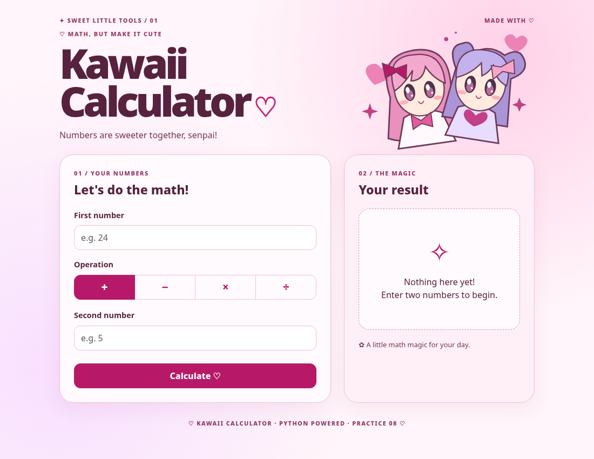

# Kawaii Calculator ♡ — Practice 8

Веб-интерфейс существующего Python-калькулятора для курса AI automation. Практики 7.1 и 7.2 (n8n) не изменены. Исходный `src/calculator.py` сохранён: веб-интерфейс использует четыре бинарные операции, функция average остаётся доступна в Python.



## Запуск

Python 3.11–3.13. Из корня репозитория:

```bash
python -m venv .venv
```

Активировать: Windows PowerShell — `.venv\Scripts\Activate.ps1`; macOS/Linux — `source .venv/bin/activate`.

```bash
python -m pip install -r requirements-dev.txt
python -m playwright install chromium
python -m uvicorn src.api:app --reload
```

Открыть http://127.0.0.1:8000/ . API документация: http://127.0.0.1:8000/docs . Никакие ключи, Node.js и внешние CDN не нужны.

## Сценарий и дизайн

Пользователь, которому нужны простые вычисления, вводит два числа, выбирает операцию и нажимает Calculate (или Enter). Результат вычисляется на Python и появляется в карточке. Визуальный стиль — pink kawaii, две оригинальные SVG chibi-маскотки, розово-сиреневая палитра.

[Интерактивный HTML-прототип](docs/prototype.html) — открыть локально из клонированного репозитория, переключить состояния в верхнем списке. Это отдельный дизайн-макет, без обращения к API. [Описание AI и проверок](docs/AI.md).

Библиотека компонентов: Bootstrap 5.3.6 (локальный CSS, MIT), используются `card`, `form-control`, `btn`, `btn-group`, `alert`, `spinner-border`, адаптивная сетка. Общие цвета, шрифты и размеры в `frontend/style.css`. Подписи полей, radio-группа, видимый фокус, aria-live, клавиатура и мобильная сетка.

## API

`POST /api/calculate` с JSON `{"a":24,"b":5,"operation":"multiply"}` → `{"result":120.0}`. Операции add, subtract, multiply, divide. Деление на ноль → HTTP 400 с `detail`; невалидные данные → 422. Фронтенд не вычисляет результат сам. Pending-флаг устанавливается до fetch, кнопка отключается до finally. Пустой ответ (204 или отсутствующий result), ошибка сети/сервера, загрузка и успех отображаются отдельно. После ошибки можно исправить ввод и повторить запрос.

## Тесты

Остановить сервер при желании: браузерные тесты сами запускают сервер на свободном порту.

```bash
python -m unittest discover -s tests -v
python -m pytest tests_ui -v
```

11 серверных/исходных тестов прошли в среде разработки: [вывод](docs/backend-test-results.txt). 8 браузерных тестов подготовлены; среда разработки блокирует HTTP-навигацию Chromium (`ERR_BLOCKED_BY_ADMINISTRATOR`), поэтому успешный запуск пока не подтверждён. Запустить локально или в [GitHub Actions](https://github.com/ssofochk/n8n-ai-automation-demo/actions) после push. Тесты подменяют API через Playwright route (успех, задержка, пустой ответ, 500), а два сценария используют настоящий сервер. Проверяются ввод, операции, ошибки, повторная отправка, клавиатура и мобильная ширина.

## Перед сдачей

Запустить клиентские тесты, сохранить реальный вывод; сделать скриншоты успешного вычисления, загрузки, пустого ответа, ошибки. Для загрузки и пустого ответа можно использовать тестовые сценарии с подменой API, явно указав это. На демонстрации использовать настоящий API. Проверить мутацию: временно убрать вызов `show('error', ...)` в catch, запустить `python -m pytest tests_ui -k error_and_retry -q`, убедиться в падении, восстановить код и повторно запустить все тесты. Не считать этот эксперимент выполненным, пока не запущен.
